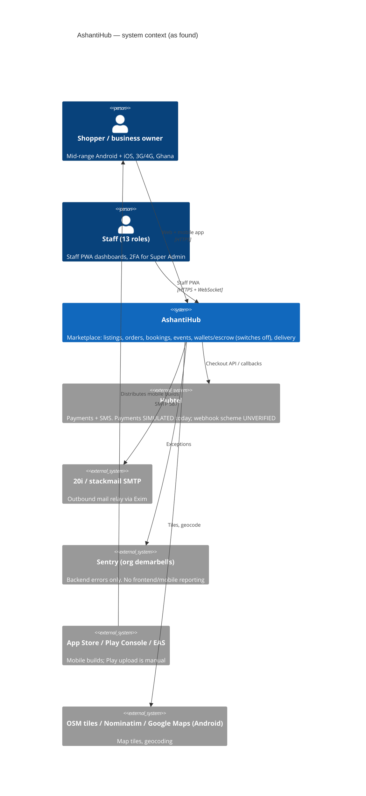
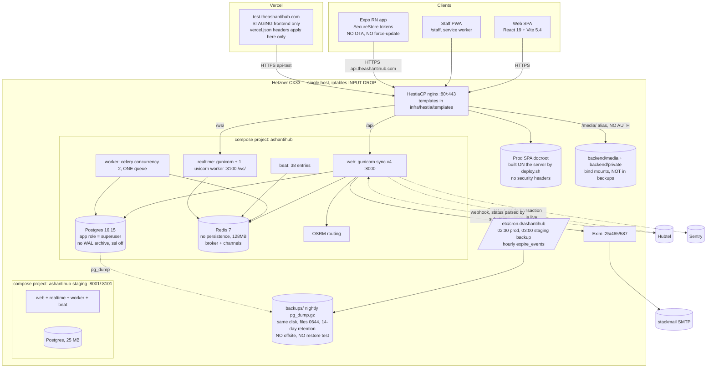

# AshantiHub — architecture as found (2026-11-06)

Derived from `infra/compose/docker-compose.yml`, `infra/hestia/templates/`, `infra/README.md`, `deploy.sh`, `ss -tlnp`
and `docker compose ps` on the staging stack, response headers from the live hosts, and the source. Evidence: `docs/reviews/evidence/`.

## C4 level 1 — system context

## C4 level 2 — containers (one Hetzner CX33: 4 vCPU / 8 GB / 80 GB, prod + staging side by side)

## Documented vs found — gap list

| # | Documented / assumed | Found | Evidence |
|---|---|---|---|
| 1 | `settings.py:708-710`: media is "served to anyone", so private files must use private storage | Ghana Card, business certificate, signboard and dispute images are written to public `MEDIA_ROOT` and nginx serves `/media/` with no auth | `accounts/models.py:455-477`, `ashantihub-api.stpl.in:36`, staging HEAD returned 200 |
| 2 | `infra/README.md`: nightly backups, 14-day retention | Same disk as the DB, no offsite, no WAL, files 0644, no restore test, uploads not backed up | `backup-db.sh`, `ls -l backups` on staging |
| 3 | `orders/views.py:89-93`: webhook empties the cart | No cart code in the finalizer; only the simulated branch clears it | `payments/services.py:40-58` |
| 4 | Frontend "hosted on Vercel" (my brief) / `frontend/vercel.json` header policy | Only **staging** is on Vercel. Production is nginx with server-built assets and no HSTS/CSP/XFO | `curl -I https://theashantihub.com` |
| 5 | Mobile API client generated from OpenAPI (my brief) | Hand-written fetch wrapper, 79 unchecked `as T` casts; OpenAPI schema exists unused | `mobile/src/lib/api.ts` |
| 6 | `frontend/CLAUDE.md`: App.jsx "~4,000 lines" | 3,478 lines | `wc -l` |
| 7 | `docs/HUBTEL_INTEGRATION.md:62`: `POST /api/payments/checkout/` | Endpoint does not exist | grep |
| 8 | Hardening spec G1–G5 | "Nothing built" at HEAD: throttles, lockout, field encryption | `2026-10-16-security-hardening-design.md` vs code |
| 9 | CLAUDE.md "verify-before-merge gate" | Exists only as prose for an AI agent; no `.github`, no hooks, `deploy.sh` runs no tests | `ls -a`, `deploy.sh` |
| 10 | Docker health = app healthy | `/api/health/` returns 200 without touching DB or Redis | `core/views.py:46-48` |
